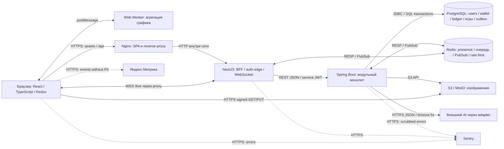
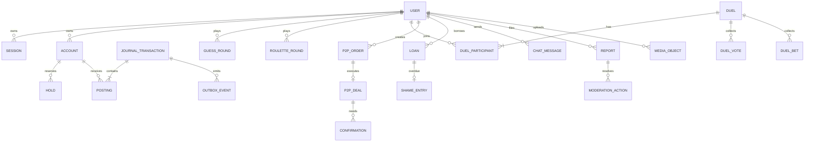
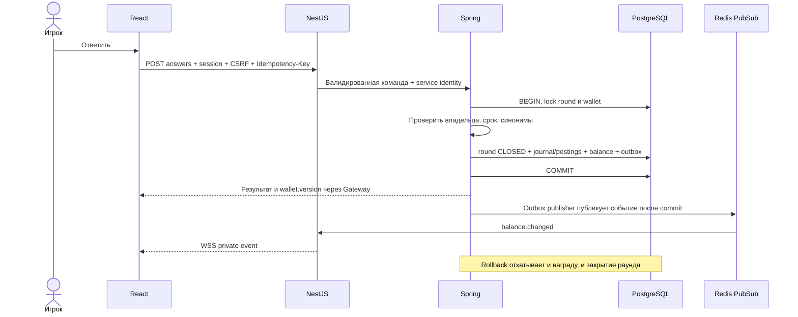
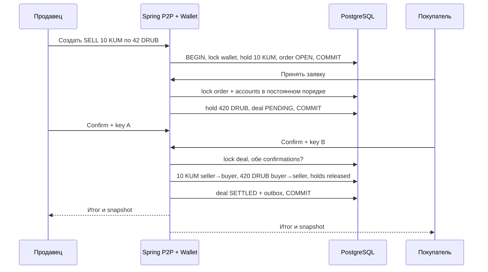
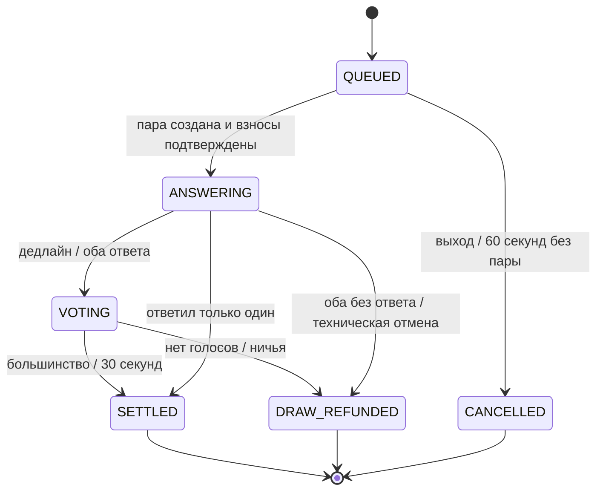

# G2.1 — целевая архитектура

Это подробное техническое приложение. Для первого знакомства используйте [общую архитектуру](../architecture.md): она показывает систему целиком и объясняет компоненты простыми словами. [Главная схема PNG](../img/architecture.png) и [PlantUML-исходник](../G2_1.puml) подготовлены в компактной компонентной подаче Vie / Git Зрение; DFD и схемы пользовательских веток сохранены отдельно.

Статус: описание конечного результата, представляемого на G2. Презентуемые возможности фиксируют обязательства по реализации; текущий артефакт — статичные схемы и спецификации. Канонические правила — [product-rules.md](product-rules.md). Визуальные материалы: [архитектура, DFD и пользовательские схемы](diagrams.md).

## 1. Стиль и границы

Клиент-серверная система: React SPA → NestJS BFF / WebSocket gateway → **модульный монолит Spring Boot**. Один владелец доменной логики, одна PostgreSQL для транзакций между играми, кошельком и P2P. Отдельных микросервисов игр и распределённых финансовых транзакций в G2 нет. NestJS оправдан Node.js-частью задания и поддержкой браузерных live-соединений; дополнительный hop — принятый компромисс. Его можно было бы исключить при отсутствии учебного требования.

## 2. Технологии и назначение

Выбор целевого стека; конкретные patch-версии фиксируются lock-файлами при реализации. Не утверждаем, что библиотеки уже установлены в существующем root-проекте.

| Слой | Технологии / библиотеки | Для чего |
|---|---|---|
| Frontend | React, TypeScript, Vite, React Router | SPA, типизация, сборка и маршруты |
| UI | MUI, собственная тема | Компоненты, responsive, доступные формы |
| Состояние | Redux Toolkit / RTK Query | UI-state, HTTP cache, invalidation по событиям; не источник истины для денег |
| Browser API | Canvas 2D, WebAudio, Web Worker, Web Crypto | График/рулетка, звук после пользовательского жеста, агрегация, UUID |
| Gateway | Node.js, NestJS, `@nestjs/platform-ws` / `ws`, class-validator | Native WebSocket, BFF, валидация DTO, rate limit |
| Core | Java LTS, Spring Boot Web / Security / Validation / Data JPA | Доменные модули, роли, транзакции, проверка входа |
| Данные | PostgreSQL, Flyway, Spring Data Redis | SQL, миграции, временные структуры и события |
| Файлы | MinIO локально, S3-совместимый API | Объектное хранение без binary в SQL |
| Auth | Spring Security, BCrypt, server sessions | Пароли и сессии принадлежат Core |
| Контракты | OpenAPI 3.0.3, JSON Schema 2020-12 | HTTP DTO и WS envelope; генерация моделей при реализации |
| Инфраструктура | Docker, Docker Compose, Nginx | Локальный запуск, same-origin proxy, TLS на внешней границе |
| Качество | ESLint, Prettier, stylelint, Vitest, RTL, Playwright; JUnit, Testcontainers; Jest для gateway | Формат, UI/unit, e2e, настоящие PG/Redis в integration |
| Наблюдаемость | Sentry SDK, Яндекс.Метрика, Spring Actuator | Ошибки, воронка, readiness/liveness |

Транспорт — native WebSocket, не Socket.IO: клиент и сервер используют один согласованный протокол `/live`. В production DB/Redis/S3 соединения шифруются при выходе из доверенной сети; локальные compose-протоколы описаны отдельно.

## 3. Модули и ownership

| Модуль | Ответственность / данные | Владелец |
|---|---|---|
| `web/auth`, `terminal`, `games`, `market`, `p2p`, `chat`, `bank`, `profile`, `moderation` | Экранные состояния; общий API client; ошибки; UI не хранит скрытые ответы | Даниил |
| `gateway/auth-edge` | Чтение cookie, introspection сессии через Core, CSRF/Origin, rate limit, никакого самостоятельного ledger | Ян |
| `gateway/live` | Соединения и подписки, авторизация комнат, WS envelope, forwarding в Core | Ян |
| `core/identity` | Users, роли, BCrypt, сессии, SCAM; проверка прав повторно в Core | Ян |
| `core/wallet` | Accounts, holds, journal transactions и postings; единственный модуль, меняющий деньги | Ян |
| `core/guess`, `roulette`, `duels` | Машины состояний игр, deadlines, ответы, голоса, расчёт через wallet | Ян |
| `core/p2p` | Жизненный цикл ордера/сделки, принятие и подтверждения; вызывает wallet | Ян |
| `core/loans` | Eligibility, выдача, погашение, dueAt, SCAM и запись доски | Ян |
| `core/chat`, `moderation`, `reviews` | Сообщения, AI-предпросмотр, жалобы, шаблоны историй, аудит | Ян; Матвей — контракты и review |
| `core/market` | Единственный генератор, OHLC история, ticks | Ян |
| `core/media` | Метаданные, signed URLs, проверка загрузки | Ян |
| `core/jobs`, `outbox` | Просрочки, таймауты, возобновляемая публикация событий | Ян; Матвей — интеграция |
| `infra`, `contracts`, `observability` | Compose, proxy, secrets, схемы, CI и error reporting | Матвей |

Модули Spring взаимодействуют через application services / доменные интерфейсы, а не запись в чужие таблицы. Gateway не имеет DB-credentials. Один monorepo: `apps/web`, `apps/gateway`, `services/core`, `packages/contracts`, `infra`, `docs` — целевая структура, пока не создаваемая пустыми заглушками.

## 4. Модель данных

Основные поля и ограничения:

- `users(id, nickname, password_hash, role, status, version)`; nickname уникален после нормализации. `sessions(id_hash,user_id,expires_at,revoked_at)` в PG; Redis-кеш сессии короткоживущий, недоступность Redis не теряет аккаунт.
- `accounts(id, owner_id, currency, balance_minor, held_minor, version)`; unique(owner,currency); check `balance>=0`, `held>=0`, `held<=balance` для пользовательских счетов. Доступно = balance − held.
- `journal_transactions(id, actor_id, operation_type, entity_id, idempotency_key, request_hash)`; unique(actor,operation_type,idempotency_key). `postings(tx_id,account_id,currency,delta)` — append-only. Сумма delta по каждой валюте внутри tx = 0. Системные treasury/game/loan accounts — корреспондирующая сторона наград, убытков и кредита; их правила остатка отличаются от пользовательских.
- `holds(id,account_id,amount_minor,reason,entity_id,status,expires_at)`; unique(reason,entity,account). Резерв не расход и не перевод: меняет held, а не balance. Финальный расчёт снимает hold и создаёт postings в одной транзакции.
- `guess_rounds(id,user_id,image_id,answer_secret_id,rules_version,expires_at,status,score,tx_id)`; один OPEN на пользователя, уникальный reward по roundId. `answer_secrets` не входит в публичную DTO.
- `roulette_rounds(id,user_id,stake,secret_result,nonce,commit_hash,reveal_at,status,tx_id)`.
- `duels(id,status,image_id,answer_deadline,vote_deadline,version,winner_id,settlement_tx_id)`; participants unique(duel,user); votes unique(duel,voter); bets unique(duel,user). Ответы, ставки и статусы **долговечны в PostgreSQL**, Redis только ускоряет live-часть. Это уточняет опасное G1 «Redis + периодический snapshot».
- `p2p_orders(id,owner_id,side,quantity,price,status,expires_at,version)`; `p2p_deals(id,order_id unique,buyer_id,seller_id,status,expires_at,tx_id)`; confirmations unique(deal,user).
- `loans(id,user_id,principal,issued_at,due_at,status,issued_tx_id,repaid_tx_id)`; partial unique(user) where ACTIVE. `shame_entries(loan_id unique,user_id,created_at)`.
- `chat_messages`, `reviews`, `reactions` (unique user,target), `reports`, `moderation_actions` (actor, reason, timestamp), `media_objects(key,owner,mime,size,status)`, `market_candles`, `outbox_events(id,aggregate_id,aggregate_version,payload,created_at,published_at)`.

Индексы: loans(status,due_at), holds(status,expires_at), p2p_orders(status,side,price), duels(status,deadline), messages(room_id,created_at,id), ledger(account_id,created_at), outbox(published_at,created_at). Pagination — cursor/limit до 100.

## 5. HTTP API и ошибки

[openapi.json](openapi.json) описывает маршруты, request/response DTO, cookie-auth, CSRF и Idempotency-Key. Public API имеет префикс `/api/v1`; ранее показанные `/guess-rounds` были сокращениями. Gateway принимает внешнюю схему, Core использует внутренние версии тех же DTO.

Команды: POST login/register/demo/logout; POST guess-round/answer, roulette-round; queue/answer/vote/bet; orders/accept/confirm/cancel; rewrite/message/report; loan/repay; moderation resolve. Чтения: me, wallet/ledger, snapshots, candles, orders, chat, shame, reviews. GET не меняет экономику; POST, начатый до разрыва сети, может быть уже выполнен.

Ошибки: `{"code":"INSUFFICIENT_FUNDS","message":"Недостаточно КУМ","requestId":"…","retryable":false}`. 400 — DTO, 401 — нет сессии, 403 — роль/SCAM/CSRF, 404 — отсутствует/нет доступа, 409 — состояние/уже принято/изменился payload ключа, 413 — файл, 415 — MIME, 422 — бизнес-правило, 429 — rate limit + Retry-After, 503 — временная недоступность. Для идемпотентного повтора тот же request hash возвращает прежний результат; другой payload с тем же ключом → 409.

Core повторно проверяет `userId`, роль, сессию и владение сущностью: заголовок с произвольным `userId` от браузера не доверенный. Gateway передаёт короткоживущий подписанный service JWT с audience Core и requestId; Core доступен только во внутренней сети.

## 6. WebSocket

`WSS /live`: native WebSocket, session cookie из handshake, строгая проверка Origin. Сообщения UTF-8 JSON. Cookie при same-origin прикладывает браузер; токен в URL не используется. Соединение без авторизации может подписываться только на public market/duel snapshots. Для приватной комнаты сервер сверяет пользователя. При revoke/SCAM соединение перечитывает права; приватные команды всё равно проверяет Core.

Формат из [events.schema.json](events.schema.json): `eventId, eventVersion, type, aggregateId, aggregateVersion, occurredAt, requestId, payload`. Client message: `type=subscribe/unsubscribe/ping`, `requestId`, `topics`. Сервер: `subscribed`, `pong`, `price.tick`, `balance.changed`, `duel.updated`, `duel.settled`, `order.updated`, `chat.message`, `loan.overdue`, `error`. Серверные heartbeat каждые 25 секунд, закрытие после 60 секунд без pong; reconnect клиента с backoff 1/2/4/8…30 секунд и jitter. После reconnect — HTTP snapshot; Redis Pub/Sub не replay-log.

Дубликаты удаляются по eventId. Устаревшие aggregateVersion не применяются. Пропуск версии → snapshot. Пользовательский баланс передаётся только в приватную комнату. Медленный клиент получает только последний price.tick; при переполнении очереди соединение закрывается с предложением resync. Команды, меняющие деньги, идут по HTTP с Idempotency-Key. WS служит доставке обновлений, а не гарантией расчёта.

## 7. Критические последовательности

## 8. Транзакции и доставка

Деньги: Spring `@Transactional`, PostgreSQL row locks (`SELECT FOR UPDATE`) на раунде/сделке/кошельках; счета блокируются по ID для снижения deadlock. Повтор deadlock — ограниченный retry с прежним idempotency key. Прикладные constraints проверяются в той же транзакции, БД закрепляет uniqueness. Не вызываем AI и S3 внутри финансовой блокировки.

Изменение БД и публикация события — разные системы. Поэтому `outbox_events` записывается в той же транзакции, что и баланс. Publisher читает пачки через `FOR UPDATE SKIP LOCKED`, публикует, затем помечает delivered; падение между publish и отметкой создаёт дубликат. Доставка at-least-once до Redis, но клиент может пропустить Pub/Sub — состояние восстанавливается snapshot. Не заявляем exactly-once transport; гарантируем единственный финансовый эффект ограничениями БД и idempotency.

Matchmaking: Redis ускоряет очередь; атомарное извлечение пары через Lua. Матч и оба взноса фиксируются в PG с уникальными активными участниками. При падении между извлечением и commit watchdog восстанавливает очередь из записей reservations; истёкшие ожидания освобождают hold. При потере Redis новые live-матчи приостановлены, уже существующие сущности доступны через PG и jobs.

Jobs в том же Spring-приложении: закрытие игр по server deadlines, просрочка кредита, P2P timeout, снятие истёкших hold, outbox retries, генерация курса. При нескольких экземплярах задачи выбираются с row-lock / lease, а не запускаются независимо для одной сущности. После рестарта overdue-записи обрабатываются по dueAt в PG, без зависимости от in-memory таймеров.

## 9. Auth, файлы, AI

Пароль BCrypt, opaque session ID 32 случайных байта; в PG только hash ID. Cookie `HttpOnly; Secure; SameSite=Lax; Path=/`; TTL 24 часа, logout отзывает сессию. POST требует CSRF token, полученный `/auth/csrf`, и проверку Origin; login тоже защищён. Rate limit login по IP/ник; не возвращать детали существования ника при неверном входе. Демо — настоящий ограниченный server session при реализации; reset разрешён только demo-owner. Роли и SCAM проверяются Core для каждой команды, статус не берётся из Redux.

Загрузка: Core проверяет размер/роль, выдаёт короткий signed PUT на отдельный prefix. После upload → complete: HEAD, реальное декодирование image, размеры, MIME/signature, отклонение SVG/активного контента, удаление EXIF, умеренные dimension limits. До проверки объект не публичен. Signed GET только проверенных медиа; ответы игр не в имени файла/metadata. Локально MinIO, CORS ограничен origin приложения. Потенциально опасные внешние ссылки не загружаются сервером произвольно.

AI provider вызывается через интерфейс `RewriteProvider`, таймаут 5s, без автоматической публикации. MockProvider по умолчанию для офлайн демо и воспроизводимых тестов; внешняя модель включается конфигурацией. API key только server secret. В prompt отправляется только необходимый текст, без session и личных реквизитов. Любой результат проходит обычную проверку чата. Не используем AI для начисления баланса или определения победы.

## 10. Развёртывание и отказы

Целевой `docker compose up --build`: `web/nginx`, `gateway`, `core`, `postgres`, `redis`, `minio`. PostgreSQL и MinIO с persistent volumes, Redis можно восстановить. Только web-порт наружу; внутренние сервисы не публикуют production-порты. Внешний TLS terminator отдаёт assets, `/api/v1` и `/live` с одного origin; WebSocket upgrade и разумный idle timeout в proxy. Sentry/Метрика/AI — необязательные внешние интеграции.

Health: Core `/actuator/health/liveness` без внешних зависимостей; readiness проверяет PG, миграции, необходимые компоненты. Gateway readiness проверяет Core; WS degraded сообщается отдельно. Секреты — env/secret mounts, `.env.example` без значений. Backup PG и объектов, проверяемая процедура restore; Redis backup не заменяет PG backup.

| Отказ | Поведение и восстановление |
|---|---|
| UI закрылся после команды | Получить сущность или повторить тот же idempotency key; не запускать новый раунд вслепую |
| Core упал до commit | Rollback: деньги и статус не изменились |
| Core упал после commit до ответа | Повтор возвращает сохранённый результат |
| Redis / PubSub недоступен | Данные в PG сохраняются, live degraded, UI перечитывает snapshot |
| Outbox publisher упал | Повтор после рестарта, возможно дублирование события, не выплаты |
| AI недоступен | Исходный текст остаётся, отправка без переписывания |
| S3 недоступно | Не начинаем новый раунд без валидной картинки, незавершённая загрузка не публикуется |
| Scheduler отставал | Сравнение deadlines выполняется и на командах; jobs догоняют после запуска |
| Analytics / Sentry недоступны | Не блокируют пользовательские транзакции |

Начальное допущение нагрузки: до 100 одновременно подключённых пользователей, 10 команд/с, один регион. Это бюджет проектирования, не измеренный результат. Цели: p95 обычного HTTP <500мс без AI, доставка live в нормальной сети <1с, 30–60 fps для графика на целевом ноутбуке, финализация deadlines с лагом jobs до 5с. Нужны нагрузочные замеры, а не обещание подтверждённой производительности.

Масштабирование: несколько stateless Gateway/Core, Redis Pub/Sub между Gateway, PG connection pool, индексирование, только затем read replicas или отдельные сервисы по измеренной необходимости. Без sticky business state в памяти процесса. Один WebSocket остаётся прикреплён к выбранному Gateway до reconnect.

## 11. Наблюдаемость и проверка при реализации

Корреляция `requestId` проходит UI → Gateway → Core → outbox. Sentry: stack trace, environment, release, без cookies, паролей, скрытых ответов и текстов чата. Метрика: `demo_started`, `round_started`, `round_finished`, `duel_joined`, `order_completed`, `loan_taken`; только агрегированные неперсональные параметры. Мониторим p95, ошибки расчёта, lag outbox/jobs, reconnect, queue length. Клиентские успехи не подменяют серверный учёт результата.

Обязательные сценарии будущих integration/e2e: два answer одновременно → одна награда; один ключ/разный payload → 409; два accept → один контрагент; два confirm → один перевод двух валют; недостаток денег → полный rollback; погашение против overdue → один итог; ноль голосов/ничья → полный возврат; потеря Redis → восстановление дуэли из PG; падение publisher → событие повторено без повторной выплаты; SCAM через прямой API → 403; чужой round/ledger/room недоступен. UI тесты — валидация, клавиатура, mobile, AI fallback, reconnect. Проверка статичных материалов описана в verification.md.
