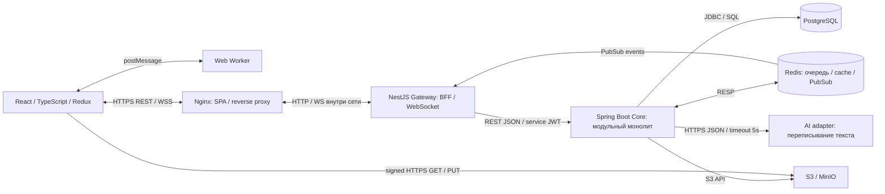
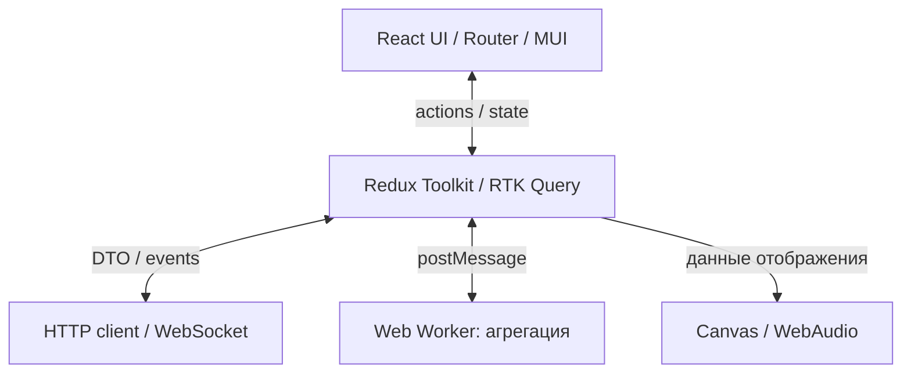
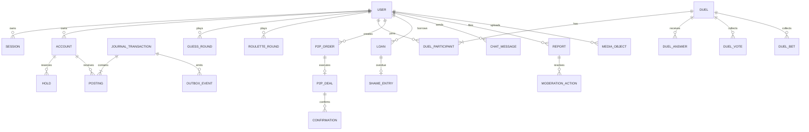
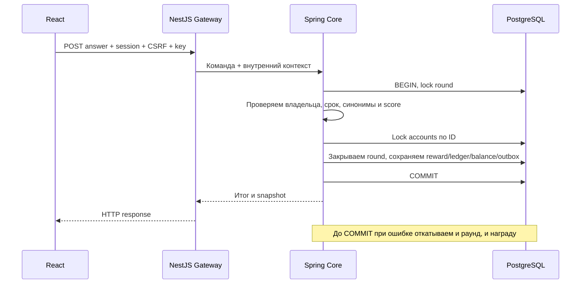
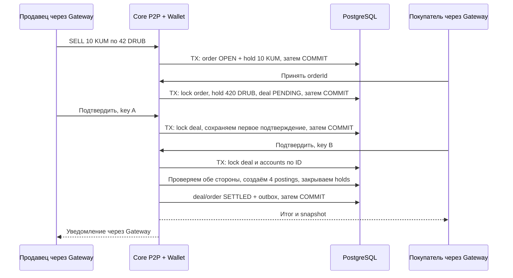
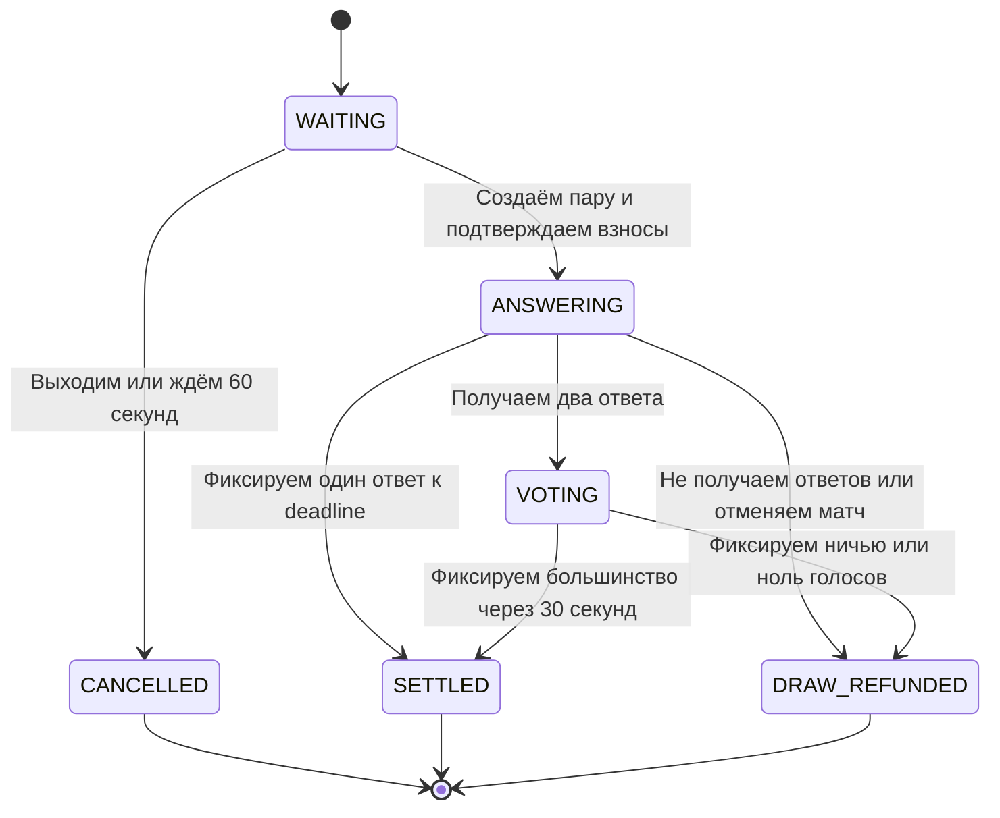

# Архитектура ДяханExchange

Для G2 мы описываем приложение на React, NestJS и Spring Boot. Основную бизнес-логику собираем в одном Spring Boot Core, внутри делим её на модули. Для пользователей, кошельков, игр, заявок и кредитов используем общую PostgreSQL.

Сохраняем основу из нашего [data-flow.md](https://github.com/maz749/dyahan-exchange/blob/main/data-flow.md). Ниже подробнее разбираем модули, данные, протоколы и расчёты. В [traceability.md](traceability.md) связываем экраны с API.

## 1. Общая схема

В браузере показываем интерфейс и анимации. Через Gateway принимаем HTTP-запросы и держим WebSocket-соединения. В Core проверяем правила, определяем исходы и меняем данные.

Используем **модульный монолит**: запускаем один Spring Boot Core и разделяем код внутри приложения. Identity, Wallet, Games, P2P и Loans не разворачиваем отдельно. Между ними вызываем Java-интерфейсы, а не HTTP. Благодаря общей БД закрываем игру и начисляем награду одной транзакцией.

Redis используем для очереди, присутствия, кеша и live-доставки. Долговечные ответы, голоса, ставки, дедлайны и результаты сохраняем в PostgreSQL. Изображения складываем в S3/MinIO, а в SQL держим метаданные.

Для ошибок подключаем Sentry, для неперсональных событий интерфейса — Яндекс.Метрику. Не отправляем туда пароли, cookie, скрытые ответы и тексты чата.

## 2. Стек

| Часть | Что используем | Для чего |
|---|---|---|
| Frontend | React, TypeScript, Vite, React Router | Собираем SPA и маршруты |
| UI | MUI, собственная тема | Оформляем страницы, формы и мобильные состояния |
| Состояние | Redux Toolkit / RTK Query | Храним UI-state и кешируем запросы |
| Browser API | Canvas 2D, WebAudio, Web Worker, Web Crypto | Рисуем график/рулетку, воспроизводим звук, агрегируем точки, создаём UUID |
| Gateway | Node.js, NestJS, class-validator, native WebSocket через ws | Проверяем DTO, ограничиваем запросы, обслуживаем WS-комнаты |
| Core | Java LTS, Spring Boot Web/Security/Validation/Data JPA | Проверяем права, выполняем бизнес-логику и транзакции |
| Данные | PostgreSQL, Flyway, Spring Data Redis | Храним данные, применяем миграции, работаем с Redis |
| Файлы | MinIO локально, S3-совместимый API | Загружаем и выдаём изображения |
| Контракты | OpenAPI 3.0.3, JSON Schema | Описываем HTTP и версионируем события отдельно |
| Инфраструктура | Docker Compose, Nginx, Actuator | Запускаем окружение, настраиваем proxy и health checks |
| Качество | ESLint, Prettier, stylelint, Vitest/RTL, Jest, JUnit/Testcontainers, Playwright | Проверяем оформление кода, UI, backend и сквозные сценарии |

Версии библиотек фиксируем при настройке сборок. Для WebSocket используем native-протокол /live, не Socket.IO. Для звука ждём действие в интерфейсе; без такого действия WebAudio не запускаем.

## 3. Как делим код

| Модуль | Что делаем внутри |
|---|---|
| web/auth, terminal, games, p2p, chat, bank, profile, moderation | Собираем экраны, формы, обработку ошибок и состояния |
| gateway/auth-edge | Проверяем cookie/Origin/CSRF, запрашиваем проверку сессии в Core, применяем rate limit |
| gateway/live | Держим соединения, проверяем подписки, отправляем разрешённые события |
| core/identity | Храним аккаунты, роли и сессии, проверяем пароль и SCAM |
| core/wallet | Ведём счета, резервы, журнал и проводки; изменяем деньги только здесь |
| core/guess, roulette, duels | Ведём раунды, ответы, голоса, ставки и дедлайны; вызываем Wallet для расчёта |
| core/p2p | Создаём заявки, принимаем контрагента, проверяем подтверждения, вызываем Wallet |
| core/loans | Проверяем условия кредита, выдаём/погашаем долг, отмечаем просрочку |
| core/chat, reviews, moderation | Принимаем сообщения, готовим AI-preview, ведём отзывы, жалобы и аудит |
| core/market, media | Генерируем общий курс, храним историю и проверяем изображения |
| core/jobs, outbox | Обрабатываем дедлайны и публикуем события после сохранения данных |

Внутри Core обращаемся к другим модулям через application services. Не меняем баланс напрямую из P2P или Games: проводим изменение через Wallet, но в той же SQL-транзакции. Не открываем Gateway доступ к PostgreSQL.

Для репозитория планируем apps/web, apps/gateway, services/core, packages/contracts, infra и docs. В contracts держим DTO и схемы событий.

Наши зоны работы: Ян — backend, Gateway и БД; Даниил — frontend и QA. За планирование, архитектуру, интеграцию и review отвечаю я, Матвей.

## 4. Что делаем на клиенте

В Redux храним состояние интерфейса, в RTK Query — кеш ответов. Баланс в браузере используем только для показа; окончательное значение берём с сервера. При обновлении учитываем версию snapshot и не применяем старые события.

В Worker агрегируем точки графика. В Canvas рисуем график и колесо, в WebAudio воспроизводим эффекты. Не выбираем исход рулетки в анимации и не начисляем награду на клиенте.

После разрыва сети сохраняем ввод, показываем проблему, переподключаем WebSocket и перечитываем snapshot по HTTP. Не начинаем новую игру автоматически вместо принятой сервером команды.

## 5. Данные и ограничения

На схеме показываем основные отношения общей БД. Для таблиц задаём следующие поля и ограничения:

- users: id, nickname, normalized_nickname, password_hash, role, status, version. Проверяем уникальность нормализованного ника.
- sessions: id_hash, user_id, expires_at, revoked_at. В SQL сохраняем только hash session ID; Redis-кеш не используем вместо постоянного хранения.
- accounts: id, owner_id, currency, balance_minor, held_minor, version. Задаём unique(owner_id,currency). Доступный остаток считаем как balance − held.
- journal_transactions: id, actor_id, operation_type, entity_id, idempotency_key, request_hash, result. Задаём unique(actor,operation_type,key); системные операции отдельно защищаем уникальным ключом.
- postings: tx_id, account_id, currency, delta_minor, created_at. Не изменяем и не удаляем старые проводки; проверяем нулевую сумму delta по каждой валюте внутри транзакции.
- holds: id, account_id, amount_minor, reason, entity_id, status, expires_at. Не создаём второй резерв для той же сущности/счёта.
- guess_rounds: id, user_id, image_id, answer_secret_id, rules_version, expires_at, status, score, tx_id. Допускаем один OPEN на аккаунт и одну награду на раунд.
- roulette_rounds: id, user_id, stake_minor, secret_result, nonce, commit_hash, reveal_at, status, tx_id. До reveal не раскрываем секретные поля.
- duels: id, status, image_id, answer_deadline, vote_deadline, winner_id, settlement_tx_id, version. Для участников, ответов, голосов и ставок используем отдельные таблицы.
- duel_queue_entries: id, user_id, hold_id, expires_at, status, duel_id. Отделяем ожидание пары от уже созданного матча.
- p2p_orders: id, owner_id, side, quantity, price, status, expires_at, version. В p2p_deals задаём unique(order_id), в confirmations — unique(deal_id,user_id).
- loans: id, user_id, principal, issued_at, due_at, status, issued_tx_id, repaid_tx_id. Допускаем один ACTIVE-кредит. Для shame_entries задаём unique(loan_id), аккаунт определяем через loan.
- chat_messages, reviews, reactions, reports, moderation_actions: сохраняем сообщения, вымышленные отзывы, реакции, жалобы и решения с причиной/автором/временем.
- media_objects: object_key, owner_id, mime, size, status; market_candles: время и OHLC; outbox_events: id, aggregate_id, aggregate_version, type, payload, created_at, published_at.

Для денежных значений используем bigint, в JSON передаём decimal string. Float не используем. Для обычного аккаунта обеспечиваем balance ≥ 0 и 0 ≤ held ≤ balance. Для наград, потерь и кредита используем корреспондирующие системные счета с отдельными правилами остатка.

Резерв не считаем расходом: меняем held, а не balance. При расчёте одной транзакцией закрываем резерв, создаём проводки и меняем остаток. Для P2P проводим обе валюты одновременно.

Создаём индексы по status/deadline игр, loans(status,due_at), holds(status,expires_at), orders(status,side,price), messages(room_id,created_at,id), ledger(account_id,created_at,id), pending outbox. Для списков используем cursor pagination с limit до 100.

## 6. API и сессии

Публичные пути начинаем с /api/v1. Короткие маршруты из G1 сохраняем внутри этого префикса. В [traceability.md](traceability.md) перечисляем действия и модули.

Для входа используем BCrypt и случайный opaque session ID из 32 байт. Выдаём cookie с HttpOnly, Secure, SameSite=Lax, Path=/ и сроком 24 часа. При logout отзываем сессию. На POST проверяем CSRF и Origin, включая login. Ограничиваем попытки входа по IP/нику и не раскрываем существование аккаунта ошибкой пароля.

В Gateway удаляем входящие user/service headers и передаём в Core короткоживущий подписанный service JWT с audience и requestId. В Core повторно проверяем сессию, роль и владельца сущности. Не доверяем userId из браузера. Core оставляем во внутренней сети.

Для финансовых POST требуем Idempotency-Key и сохраняем hash запроса вместе с результатом. При повторе того же ключа/payload возвращаем прежний итог; при другом payload возвращаем 409. GET используем только для чтения.

Ошибки возвращаем в формате code, message, requestId, retryable. Различаем 400 — DTO, 401 — сессия, 403 — права/SCAM/CSRF, 404 — ресурс/доступ, 409 — состояние/повтор ключа, 413 — размер, 415 — MIME, 422 — бизнес-условие, 429 — rate limit с Retry-After, 503 — недоступность зависимости.

## 7. Как выполняем расчёты

### Угадайка

При правильном ответе начисляем 1 KUM; при неверном или просроченном ответе закрываем раунд без награды. Скрытый ответ и словарь синонимов в клиент не передаём. Если теряем ответ после commit, повторяем запрос с прежним ключом и не начисляем второй раз.

### Рулетка

До старта выбираем на сервере результат 1–10 через SecureRandom. Сохраняем nonce из 32 случайных байт и commit SHA-256(roundId|result|nonce), резервируем ставку 2 KUM. При 1–5 начисляем чистый выигрыш +2 KUM, при 6–10 списываем 2 KUM.

Раскрываем результат по серверному deadline, не по callback Canvas. GET reveal используем только для чтения; расчёт проводим через команду/фоновое задание. После закрытия вкладки продолжаем обработку на сервере. Через commit/reveal проверяем неизменность сохранённого результата, но не заявляем доказуемую честность первоначального выбора.

### P2P

Разрешаем принять заявку только одному контрагенту и не разрешаем принять свою. При втором подтверждении проверяем обе стороны, срок и состояние, затем обмениваем обе валюты одной транзакцией. Confirm, cancel и timeout сериализуем блокировкой одной сделки.

До расчёта при отмене или через 5 минут возвращаем оба резерва. После SETTLED повторно не обмениваем и не отменяем. Не используем реальные банковские переводы: DRUB — игровая единица. Цену ордера не привязываем автоматически к графику.

### Дуэль

На этой схеме объединяем очередь и матч для просмотра всего пути. WAITING/CANCELLED храним у записи очереди, а ANSWERING/VOTING/SETTLED/DRAW_REFUNDED — у дуэли.

Резервируем по 5 KUM, даём до 60 секунд на ответы и 30 секунд на голосование. Не принимаем голоса и ставки от игроков. От каждого зрителя принимаем одну ставку 1–100 KUM до раскрытия ответов и один голос в фазе VOTING. Переход фазы и приём ставки защищаем lock одной дуэли, поэтому не принимаем позднюю ставку одновременно с reveal.

При одном ответе фиксируем техническую победу. При отсутствии ответов, ничьей или нуле голосов возвращаем взносы и ставки. Для этой версии выбираем возврат, без overtime. Банк игроков и зрительский пул считаем отдельно; зрительские выплаты делим пропорционально с детерминированным распределением целочисленного остатка. Если выигравших ставок нет, возвращаем зрительский пул.

Matchmaking ускоряем Redis/Lua, но очередь и резервы сохраняем в PostgreSQL. Создаём матч, двух участников и связь с резервами одной транзакцией. При сбое после извлечения пары из Redis восстанавливаем очередь по SQL-записям. При reconnect возвращаем прежний duelId, не начинаем новый матч.

## 8. Кредит и доска позора

Выдаём 10 KUM под 0% на 24 реальных часа только при нулевом доступном KUM, без активного кредита и резервов. Перед выдачей блокируем необходимые записи и одной транзакцией создаём долг, проводки и начисление. Не вводим частичное погашение и продление.

При погашении и просрочке блокируем одну loan. До dueAt принимаем полное погашение; на serverTime >= dueAt уже фиксируем просрочку. Одной транзакцией меняем долг на OVERDUE, статус аккаунта на SCAM и добавляем запись доски. Не ждём исключительно фонового таймера: проверяем срок и при защищённых командах.

Для SCAM сохраняем вход, историю и публичный просмотр. Запрещаем новые экономические действия и отправку в чат. Уже начатые матчи завершаем по обязательствам, чтобы не затронуть соперников; открытые очереди и заявки закрываем с возвратом резервов. Не удаляем аккаунт и финансовую историю.

Для обычного аккаунта восстановление из SCAM в G2 не предусматриваем. В демо оставляем сброс: сначала завершаем или отменяем незакрытые обязательства, затем восстанавливаем демо-баланс/статус отдельными аудируемыми операциями. Не стираем проводки и не меняем деньги соперников.

## 9. Транзакции, события и восстановление

Для расчётов используем Spring @Transactional и SELECT FOR UPDATE. Блокируем счета в постоянном порядке по ID, при deadlock делаем ограниченный retry с прежним ключом. Не вызываем AI/S3 и другие внешние API внутри финансовой блокировки.

В одной транзакции сохраняем бизнес-состояние, Wallet/ledger и outbox. После commit публикуем outbox в Redis PubSub и отмечаем доставку. При сбое между publish и отметкой допускаем повтор события, но не повторяем финансовую операцию. Для нескольких publisher используем FOR UPDATE SKIP LOCKED.

Не рассчитываем на replay PubSub. Если пропускаем live-событие, восстанавливаем экран по HTTP snapshot. Отбрасываем дубликаты по eventId и старые версии aggregate. Не обещаем exactly-once транспорт.

В Core запускаем фоновые задания для закрытия раундов, P2P timeout, кредитов, очереди и outbox. Дедлайны сохраняем в PostgreSQL, после рестарта обрабатываем просроченные записи. Для нескольких реплик используем leases/row locks, а не независимые таймеры в каждом процессе.

## 10. WebSocket, изображения и чат

Для WSS /live проверяем Origin и session cookie. Разрешаем гостевые подписки на публичный рынок и открытые дуэли. Для private me, закрытых комнат и игровых данных проверяем права через Core.

В событиях передаём eventId, eventVersion, type, aggregateId, aggregateVersion, occurredAt, requestId и payload. Финансовый snapshot выдаём только владельцу. В public duel snapshot не включаем скрытые ответы. Список событий и получателей приводим в traceability.md.

Отправляем heartbeat раз в 25 секунд, закрываем соединение через 60 секунд без pong. Для reconnect используем backoff с jitter до 30 секунд, повторную подписку и snapshot. Для медленного соединения объединяем price.tick до последнего значения; при переполнении закрываем соединение с требованием resync.

Для загрузки изображения выдаём signed PUT во временный prefix. На complete проверяем размер, MIME, декодирование и dimensions, отклоняем SVG, удаляем EXIF. До READY не разрешаем использование файла. В object key и metadata не записываем ответ угадайки. Для чтения выдаём signed GET, S3 credentials в браузер не отправляем.

В RewriteProvider задаём timeout 5 секунд. Сначала показываем AI-предпросмотр; публикуем только подтверждённый текст. При отказе оставляем обычную отправку. Для локальных проверок используем mock-provider; внешний ключ храним только на сервере.

Ограничиваем чат 1000 символами, ответ дуэли и условия заявки — 240. Отзывы отмечаем как вымышленные, на доске показываем ник и игровые данные без реальных реквизитов. При модерации сохраняем причину и аудит; не даём через модерацию менять ledger.

## 11. Запуск и поведение при сбоях

В Docker Compose поднимаем web/nginx, gateway, core, postgres, redis и minio. Для PostgreSQL и MinIO используем persistent volumes. Наружу выводим Nginx и HTTPS endpoint подписанных S3 URL; внутренние Java/Node/DB-порты не публикуем. SPA, /api/v1 и /live размещаем на одном origin.

В Core проверяем liveness без внешних зависимостей, readiness — по PostgreSQL/миграциям и необходимым компонентам. В Gateway проверяем доступность Core; потерю live отмечаем отдельно. Делаем backup PostgreSQL и объектов, проверяем восстановление; не используем backup Redis вместо SQL.

| Сбой | Что делаем |
|---|---|
| Теряем ответ после commit | Читаем snapshot или повторяем ту же команду с прежним ключом |
| Перезапускаем Core до commit | Откатываем незавершённую транзакцию |
| Теряем Redis/PubSub | Ограничиваем live и новые matchmaking-операции, читаем данные из PostgreSQL |
| Перезапускаем publisher | Повторяем событие без новой выплаты |
| Не можем вызвать AI | Предлагаем отправить исходный текст |
| Не можем получить изображение | Не начинаем игру без проверенной картинки |
| Отстаём с jobs | Проверяем deadlines на командах и догоняем задания после запуска |
| Не можем отправить аналитику | Продолжаем игровые операции |

Как ориентир берём 100 одновременных подключений и 10 команд/с. Целимся в p95 обычного HTTP до 500 мс без AI, live-доставку до 1 секунды и 30–60 fps графика. Пока не выдаём эти числа за измеренные результаты. Отдельно проверяем задержку deadline jobs, с ориентиром до 5 секунд.

При росте нагрузки добавляем stateless-реплики Gateway/Core, настраиваем pool и индексы. Через Redis PubSub доставляем обновления всем Gateway. Не держим единственное бизнес-состояние в памяти процесса и не вводим разделение Core на сервисы без необходимости.

## 12. Что проверяем при реализации

Для диагностики передаём requestId через UI → Gateway → Core → outbox. Отслеживаем ошибки расчёта, p95, задержку jobs/outbox, очередь и reconnect. Не записываем секреты и личные данные в Sentry.

Проверяем следующие сценарии:

1. Одновременно отправляем два ответа на один round — начисляем одну награду.
2. Повторяем Idempotency-Key с другим payload — получаем 409.
3. Одновременно принимаем заявку двумя аккаунтами — создаём одну сделку.
4. Одновременно подтверждаем/отменяем сделку — проводим один конечный расчёт.
5. Проверяем нехватку средств — откатываем всю операцию, не оставляем частичные проводки.
6. Совмещаем погашение и overdue — фиксируем один исход.
7. Получаем ничью или ноль голосов — возвращаем взносы и ставки.
8. Теряем Redis и восстанавливаем прежнюю дуэль из PostgreSQL.
9. Повторяем событие outbox — не выполняем выплату второй раз.
10. Проверяем прямые API-запросы SCAM и доступ к чужим round, ledger и room.
11. Закрываем вкладку до результата — завершаем принятый раунд на сервере.
12. Проверяем клавиатуру, mobile, сетевые ошибки, AI fallback и demo-reset.

В main пока держим материалы G1, поэтому готовность кода и прохождение этих тестов не заявляем. В пользовательском пути ещё уточняем две вещи: вместо варианта refund/overtime фиксируем возврат; в схеме данных сохраняем матч в PostgreSQL, а не только в Redis с периодическими snapshot. На GitHub эти изменения перенесём отдельно.
