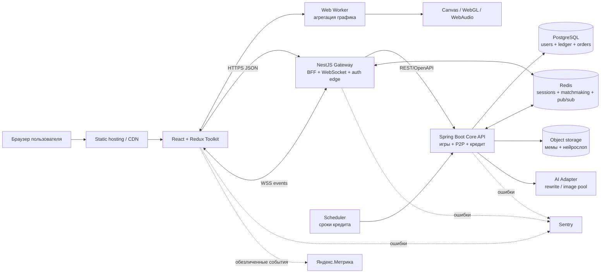
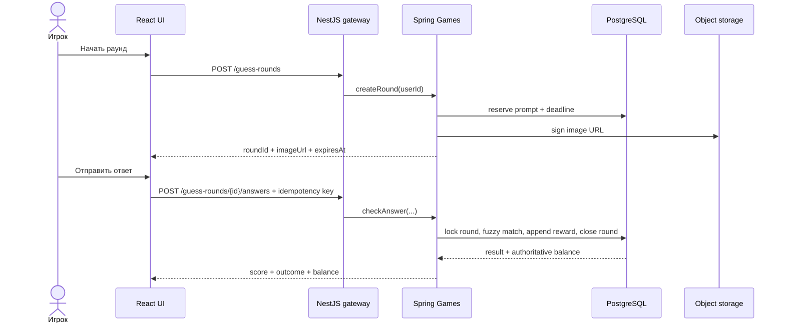
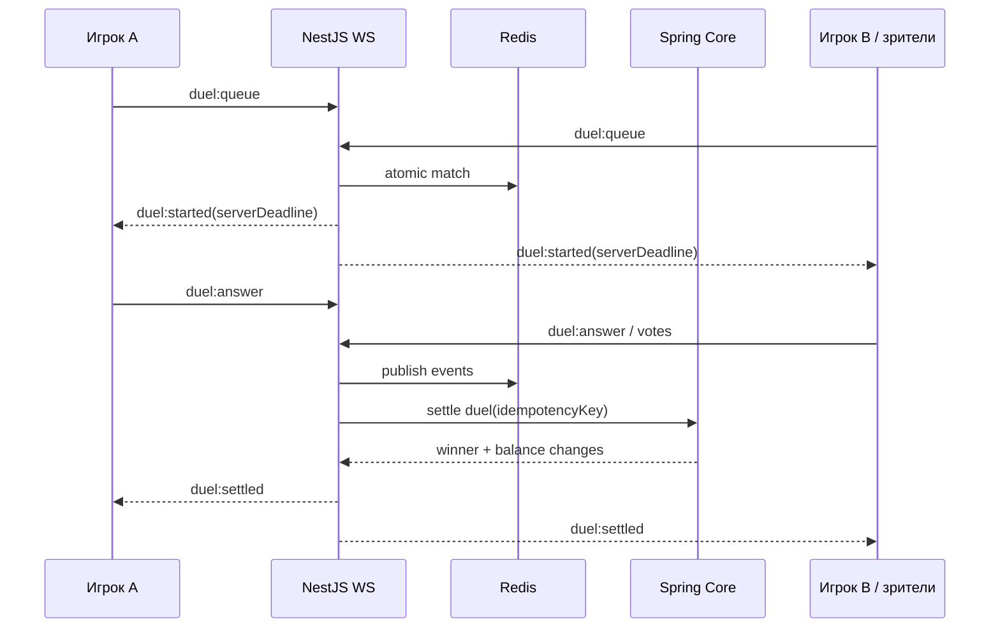

# Поток данных и архитектурная схема

## Контейнеры системы

## Владение данными

| Данные | Источник истины | Почему |
|---|---|---|
| пользователь, роли, статус | Spring/PostgreSQL | нельзя доверять клиенту |
| баланс и долг | append-only ledger в PostgreSQL | аудит и атомарные выплаты |
| P2P-ордер и резерв | Spring/PostgreSQL | защита от double spend |
| активная дуэль, presence | Redis + периодический snapshot | быстрое live-состояние и reconnect |
| изображения мемов/слопа | object storage; в БД только metadata | большие бинарные объекты отдельно |
| график в UI | Redux cache + Web Worker | быстрый render; сервер присылает события |
| настройки звука/P2P-режима | localStorage | локальное предпочтение, не ценное состояние |

Баланс хранится не одним изменяемым числом, а суммой неизменяемых записей ledger: `GAME_REWARD`, `ROULETTE_WIN`, `ROULETTE_LOSS`, `P2P_HOLD`, `P2P_SETTLEMENT`, `LOAN_ISSUED`, `LOAN_REPAID`. Каждая операция имеет `idempotencyKey`.

## Критический поток: слоп-угадайка

Скрытое название, словарь допустимых синонимов и точный порог совпадения клиенту не отправляются. До закрытия раунда ответы не попадают в аналитику и логи браузера.

## Критический поток: real-time дуэль

## Переписывание сообщения в P2P-стиль

1. Исходный текст остаётся в поле ввода.
2. Gateway применяет rate limit и передаёт текст AI adapter-у.
3. Клиент получает **предпросмотр**, чтобы пользователь подтвердил или отредактировал формулировку.
4. В чат отправляется только подтверждённый текст. Секреты и запрещённые категории блокируются до публикации.
5. При недоступности AI пользователь может отправить исходный текст — чат не блокируется внешним сервисом.

## Контракты первой вертикали

- `POST /auth/demo` — создать временного игрока.
- `GET /me` — профиль, статус, доступный/зарезервированный баланс.
- `POST /guess-rounds` — начать раунд.
- `POST /guess-rounds/{id}/answers` — проверить ответ и вернуть settlement.
- `GET /market/candles?interval=...` — начальный ряд графика.
- `WS /live` — `price.tick`, `balance.changed`, `duel.*`, `order.*`.

OpenAPI является контрактом HTTP API и источником генерации TypeScript/Java моделей. События WebSocket версионируются отдельно (`eventVersion`).
