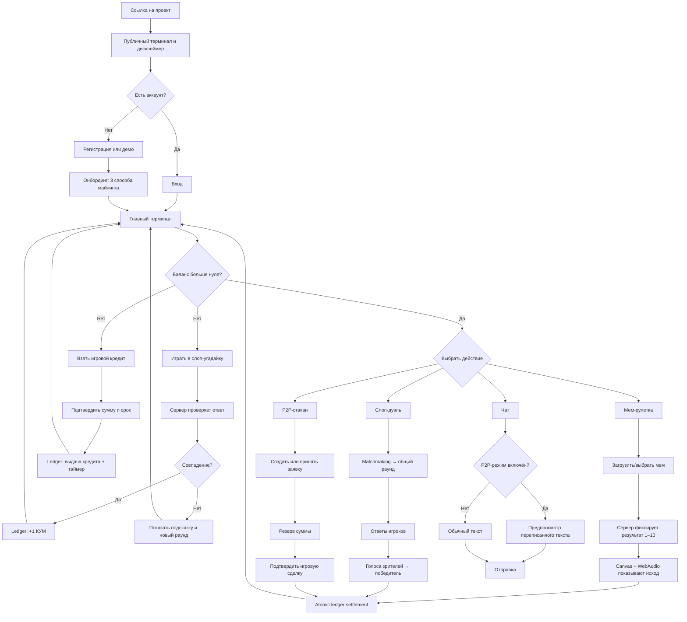

# Пользовательский flow

## Роли

- **Гость:** видит публичный терминал, курс, заявки и доску позора; может начать демо.
- **Игрок:** добывает и тратит КУМcoin, торгует, общается, берёт игровой кредит.
- **Зритель:** смотрит слоп-дуэль, ставит игровые коины и голосует.
- **Модератор:** разбирает жалобы на мемы, чат и имена пользователей.

## Сквозной путь

## Состояния и ошибочные ветки

### Слоп-угадайка

1. Клиент запрашивает раунд и получает `roundId`, изображение, срок и подсказку — без ответа.
2. Пользователь вводит вариант; кнопка блокируется от двойной отправки.
3. Сервер нормализует ответ, применяет словарь синонимов и вычисляет score.
4. Сервер атомарно закрывает раунд и при успехе добавляет запись в ledger.
5. Повторная отправка того же `roundId` возвращает прежний результат без повторной награды.

Ошибки: истёкшее время, потеря сети, уже закрытый раунд, неподходящий контент. Во всех случаях пользователь получает объяснимый статус и возможность продолжить.

### Мем-рулетка

1. До старта показываются возможная награда/потеря и текущий баланс.
2. Сервер создаёт commit результата, затем после анимации раскрывает результат.
3. Canvas рисует колесо, WebAudio проигрывает барабанную дробь только после пользовательского действия.
4. Итоговый баланс приходит с сервера; клиент никогда не считает выплату источником истины.

### Слоп-дуэль

1. Игрок входит в очередь, WebSocket сообщает статус matchmaking.
2. Оба клиента получают один `duelId`, изображение и единый server deadline.
3. После ответов открывается голосование зрителей. Ставка резервируется до результата.
4. При ничьей банк возвращается или запускается overtime по правилам раунда.
5. Reconnect восстанавливает состояние по `duelId`, а не создаёт новый раунд.

### Кредит

1. Кнопка доступна только при нулевом доступном балансе и без активного кредита.
2. Пользователь видит сумму, срок и игровые последствия до подтверждения.
3. Выплата и долг создаются одной серверной транзакцией.
4. При погашении долг закрывается. При просрочке статус меняется на `SCAM`, запись появляется на публичной доске позора.
5. Статус блокирует экономические действия, но не доступ к аккаунту и данным; в демо предусмотрен сброс.
